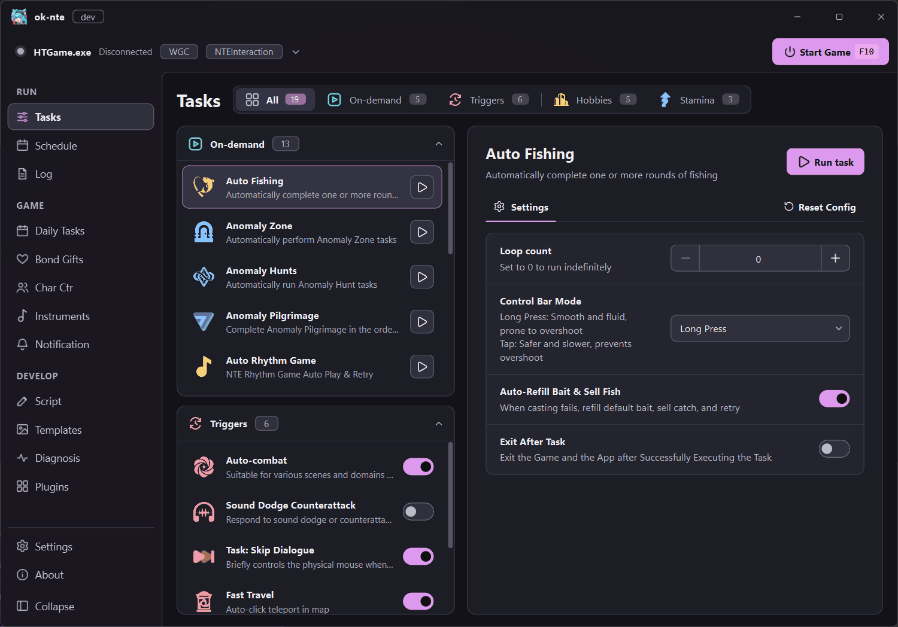

   
  <h1>ok-nte</h1>
  
An image-recognition-based automation tool for <em>Neverness To Everness</em>, with background operation support, developed based on the <a href="https://github.com/ok-oldking/ok-script">ok-script</a> framework.

English | [简体中文](README.md)

  

    
    
    
    
    
  

  

    
  

  

    <a href="docs/en/getting-started/installation.md">📥 Latest release</a> ·
    <a href="docs/en/index.md">📖 Documentation</a> ·
    <a href="docs/en/guides/quick-start.md">🚀 Quick start</a> ·
    <a href="docs/en/guides/troubleshooting.md">🛠️ FAQ and feedback</a>
  

  

    <a href="https://github.com/BnanZ0/ok-nte">Lighten the star⭐</a> &nbsp;|&nbsp; <a href="./SPONSOR.md">Sponsor the developer☕</a>
  

  

## What is ok-nte?

ok-nte is a Windows automation tool for <em>Neverness To Everness</em>. It interacts through screen recognition, OCR, system audio feedback, and ordinary keyboard and mouse input; it does not read game memory or modify game files.

## ✨ Main Features

- **Automated Tasks**: Dailies, weeklies, fishing, rhythm games, anomalies, and other instances.
- **Auto Combat**: Computer vision-based combat, Character Center, custom combo lists, and feature management.
- **Constant Triggers**: Audio-driven dodge and counter, dialog skipping, and fast travel.
- **Utilities**: MIDI-based auto piano and other auxiliary features.
- **Background Operation**: Automate game actions while in the background.

See the [feature overview](docs/en/features/overview.md) for the complete list.

## ⚠️ Disclaimer

> [!CAUTION]
> **This software is an open-source, free external tool intended for learning and exchange purposes only. It is designed to automate the gameplay of *Neverness To Everness* by interacting with the game solely through the existing user interface and in compliance with relevant laws and regulations.**
>
> - **Mechanism**: The package is intended to provide a simplified way for users to interact with the game. This package does not modify any game files or game code in any way.
> - **Purpose**: It is not meant to disrupt the game balance or provide any unfair advantage.
> - **Liability**: All issues and consequences arising from the use of this software are not related to this project or its development team. The development team reserves the final right of interpretation for this project.
> - **Commercialization**: If you encounter vendors using this software for services and charging a fee, this may cover their costs for equipment and time; any resulting problems or consequences are not associated with this software.

> [!WARNING]
> **Please Note: According to the [*Neverness To Everness* Fair Play Declaration](https://nte.perfectworld.com/en/article/news/gamebroad/20260206/260828.html):**
>
> The use of any third-party tools that undermine fair gameplay is strictly prohibited. We will take strong action against violations involving illegal tools such as cheats, speed hacks, macro scripts, and similar software.
>
> Prohibited behaviors include, but are not limited to: auto-farming, skill acceleration, god mode, teleportation, and game data manipulation. Any account found to be involved in such activities will be banned upon verification.
>
> **You should fully understand and voluntarily assume all potential risks associated with using this tool.**

## 🚀 Download & Installation

The installer is recommended for most users and supports automatic updates:

1. Go to the [**Releases**](https://github.com/BnanZ0/ok-nte/releases) page.
2. Download the latest `ok-nte-win32-Global-setup.exe` file.
3. Double-click the installer and follow the prompts.

For source setup and detailed installation steps, see the [installation guide](docs/en/getting-started/installation.md).

## 🖥️ System Requirements

- **Operating System**: Windows.
- **Game Resolution**: 1920x1080 or higher (**16:9 aspect ratio only**).
- **Game Language**: Simplified Chinese / English.

## 📚 Documentation

| What you want to do | Recommended entry |
| --- | --- |
| Use ok-nte for the first time | [Installation](docs/en/getting-started/installation.md) → [Before you start](docs/en/getting-started/configuration.md) → [Quick start](docs/en/guides/quick-start.md) |
| Learn what the project supports | [Feature overview](docs/en/features/overview.md) |
| The update is stuck or a task has problems | [FAQ and feedback](docs/en/guides/troubleshooting.md) |
| Run from source or contribute | [Development documentation](docs/en/development/running-from-source.md) |
| Read the complete documentation | [Documentation site](https://ok-script.com/ok-nte/en/docs/) |

## 💬 Community

- **Discord**: [Join](https://discord.gg/vVyCatEBgA)

## 🔗 Projects developed using [ok-script](https://github.com/ok-oldking/ok-script)

- Wuthering Waves [https://github.com/ok-oldking/ok-wuthering-waves](https://github.com/ok-oldking/ok-wuthering-waves)
- End Field [https://github.com/AliceJump/ok-end-field](https://github.com/AliceJump/ok-end-field)
- Genshin Impact (discontinued, but background story progression is still usable) [https://github.com/ok-oldking/ok-genshin-impact](https://github.com/ok-oldking/ok-genshin-impact)
- Girls' Frontline 2 [https://github.com/ok-oldking/ok-gf2](https://github.com/ok-oldking/ok-gf2)
- Honkai: Star Rail [https://github.com/Shasnow/ok-starrailassistant](https://github.com/Shasnow/ok-starrailassistant)
- Star-Resonance [https://github.com/Sanheiii/ok-star-resonance](https://github.com/Sanheiii/ok-star-resonance)
- Duet Night Abyss [https://github.com/BnanZ0/ok-duet-night-abyss](https://github.com/BnanZ0/ok-duet-night-abyss)
- Ash Echoes (discontinued) [https://github.com/ok-oldking/ok-baijing](https://github.com/ok-oldking/ok-baijing)

## ❤️ Support & Acknowledgments

### Contributors

### Sponsors

- **EXE Signing**: Free code signing provided by [SignPath.io](https://signpath.io/), certificate by [SignPath Foundation](https://signpath.org/).

### Acknowledgments

- [ok-oldking/OnnxOCR](https://github.com/ok-oldking/OnnxOCR)
- [zhiyiYo/PyQt-Fluent-Widgets](https://github.com/zhiyiYo/PyQt-Fluent-Widgets)
- [Toufool/AutoSplit](https://github.com/Toufool/AutoSplit)
- [ImLaoBJie/ZZZSoundTrigger](https://github.com/ImLaoBJie/ZZZSoundTrigger)
